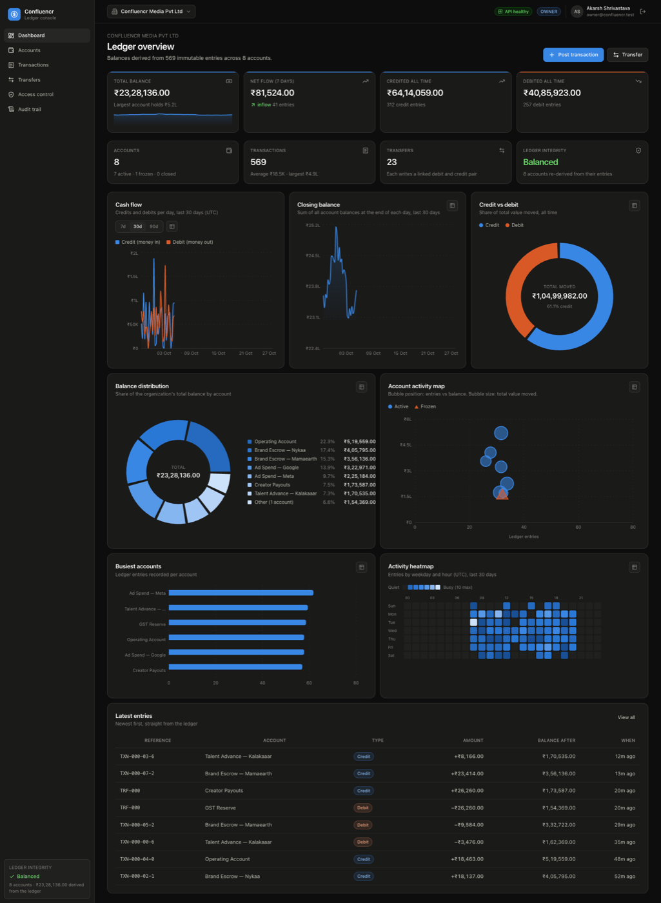
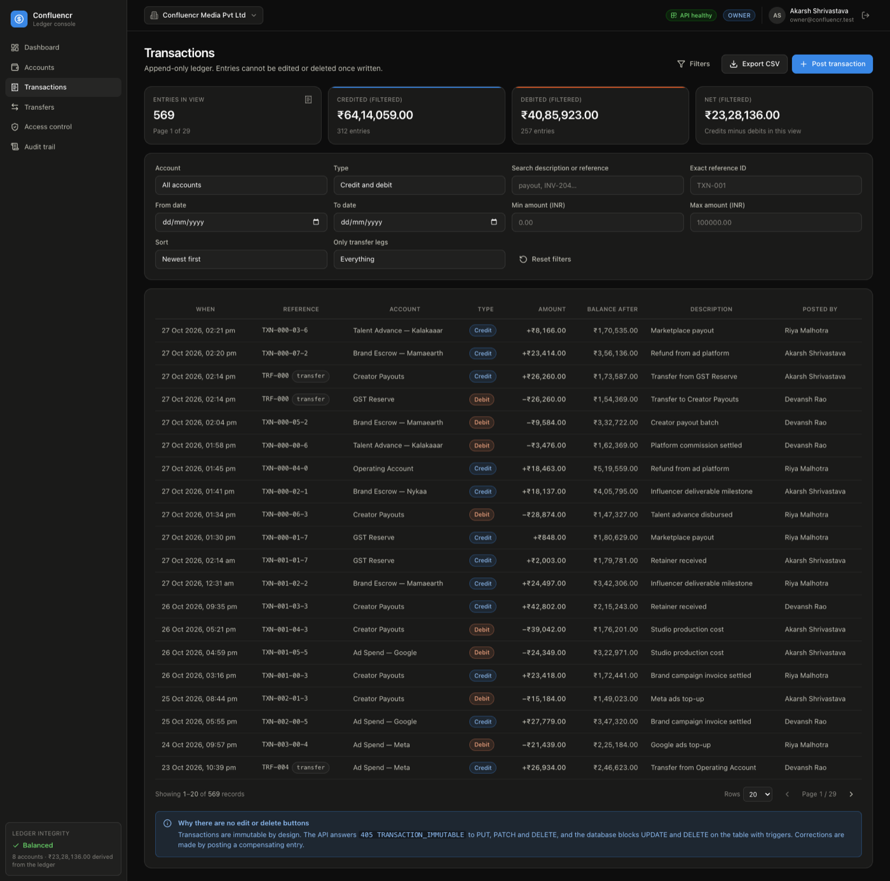
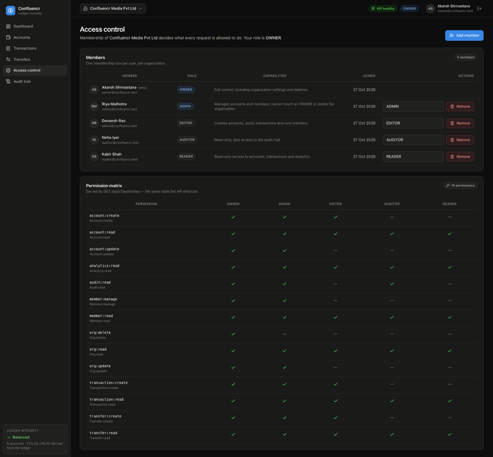
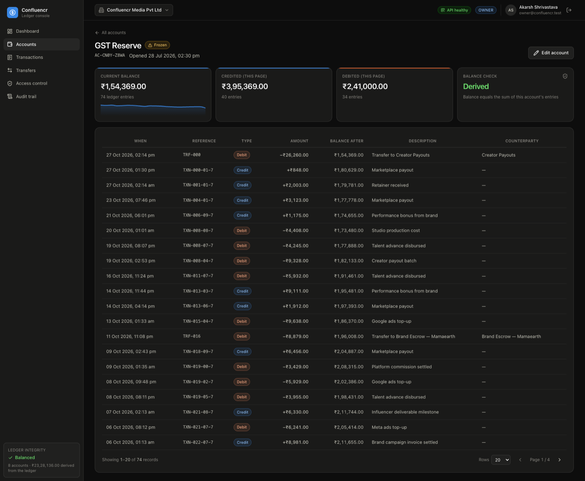

# Confluencr Ledger

A multi-tenant accounts & transactions service with an immutable ledger, atomic money
transfers, organization-level role-based access control, and an analytics console on top.

Built for the Confluencr **Sr Full Stack Developer – Gen AI** assignment.

| | |
|---|---|
| **Backend** | Node.js 20+ · TypeScript · Express · SQLite (`better-sqlite3`) · Zod · JWT |
| **Frontend** | React 18 · TypeScript · Vite · TanStack Query · Recharts · Tailwind CSS v4 |
| **Tests** | Vitest + Supertest — **117 tests, 8 suites**, all passing |
| **Database** | SQLite file, created and migrated automatically on first run |

---

## 1. Quick start

Requirements: **Node.js ≥ 20.11** and npm. Nothing else — SQLite ships inside the
`better-sqlite3` dependency, so there is no database server to install or configure.

**One command from the repository root:**

```bash
npm run setup     # installs both apps, creates .env files, seeds the database
npm run dev       # API on :4000 and console on :5173
```

**Or step by step:**

```bash
# 1 — API
cd backend
cp .env.example .env
npm install
npm run seed          # creates ./data/confluencr.sqlite with 90 days of demo data
npm run dev           # http://localhost:4000

# 2 — Web console (second terminal)
cd frontend
npm install
npm run dev           # http://localhost:5173
```

Open <http://localhost:5173> and sign in with any seeded account below.

### Demo logins

Password for all five: `Password123!`

| Email | Role | What it can do |
|---|---|---|
| `owner@confluencr.test` | OWNER | Everything, including organization settings |
| `admin@confluencr.test` | ADMIN | Accounts, members, audit trail — cannot touch an OWNER |
| `editor@confluencr.test` | EDITOR | Post transactions, run transfers, create accounts |
| `auditor@confluencr.test` | AUDITOR | Read-only **plus** the audit trail |
| `reader@confluencr.test` | READER | Read-only |

The seed also creates a second organization (*Intent Farm Performance*) that only the
owner and admin belong to, so tenant isolation is visible in the organization switcher.

> `npm run seed` **deletes and rebuilds** the database file at `DATABASE_PATH`. Use
> `npm run migrate` instead if you want an empty database without touching existing data.

### Useful commands

| Command | Where | What it does |
|---|---|---|
| `npm run dev` | `backend/` | API with hot reload on `:4000` |
| `npm run build && npm start` | `backend/` | Compile to `dist/` and run the compiled server |
| `npm test` | `backend/` | Full Vitest suite against in-memory SQLite |
| `npm run migrate` | `backend/` | Create/verify the schema, print the tables |
| `npm run seed` | `backend/` | Reset the database and load demo data |
| `npm run typecheck` | `backend/` | `tsc --noEmit` |
| `npm run dev` | `frontend/` | Vite dev server on `:5173`, proxying `/api` to `:4000` |
| `npm run build` | `frontend/` | Type-check and build the production bundle |
| `npm run preview` | `frontend/` | Serve the production build |

---

## 2. The console

| Dashboard | Transactions |
|---|---|
|  |  |
| KPI tiles, cash flow, closing balance, credit/debit donut, balance distribution, account bubble map, busiest accounts, activity heat map | Filter by account, type, text, date range and amount range; paginated, latest-first, with filtered totals and CSV export |

| Access control | Account ledger |
|---|---|
|  |  |
| Members, role changes and the live permission matrix the API enforces | Per-account statement with running balance and transfer counterparties |

More: [accounts](docs/screenshots/03-accounts.png) ·
[transfers](docs/screenshots/05-transfers.png) ·
[audit trail](docs/screenshots/07-audit.png) ·
[sign in](docs/screenshots/01-login.png)

---

## 3. What is implemented

### Core requirements

| Requirement | Where it lives |
|---|---|
| Create account, list accounts, get one account | `POST/GET /organizations/:orgId/accounts` |
| Create transaction (credit / debit) | `POST /organizations/:orgId/transactions` |
| List transactions with pagination | `GET /organizations/:orgId/transactions?page=&limit=` |
| Pagination metadata | `meta.pagination` → `page`, `limit`, `total_records`, `total_pages`, `has_next_page`, `has_previous_page` |
| Latest-first ordering | `ORDER BY created_at DESC, id DESC` (monotonic ULID tie-break) |
| Transaction immutability | No mutating routes + `405 TRANSACTION_IMMUTABLE` + database triggers |
| Balance consistency | Balance is only ever moved by a posted transaction; `GET …/ledger/integrity` re-derives every balance from the log |
| Atomicity | One SQLite `IMMEDIATE` transaction wraps the entry, the balance update and the audit row |
| Validation | Zod schemas per route + integer money parsing + database `CHECK` constraints |
| Error handling | One error envelope, stable `code` strings, correct HTTP statuses |
| **Bonus:** money transfer | `POST /organizations/:orgId/transfers` — both legs in one transaction |

### Added beyond the brief

- **Organization RBAC** — five roles (`OWNER`, `ADMIN`, `EDITOR`, `AUDITOR`, `READER`),
  a permission matrix enforced on every route, role-escalation guards, and a
  last-owner guard.
- **Multi-tenancy** — every query is scoped by `org_id`; a user can hold a different
  role in each organization they belong to.
- **Audit trail** — append-only log written inside the same transaction as the change
  it describes.
- **Analytics API** — seven endpoints that power the dashboard (cash flow, balance
  distribution, credit/debit split, per-account matrix, activity heat map, top accounts,
  ledger integrity).
- **Enterprise console** — dashboard with charts, filterable ledger, transfer flow,
  access-control screen with a live permission matrix, audit viewer, CSV export.
- **Operational niceties** — Helmet, CORS allow-list, request-id correlation, rate
  limiting, graceful shutdown, health endpoint.

---

## 4. Architecture

```
confluencer/
├── backend/
│   ├── src/
│   │   ├── app.ts                 Express app factory (middleware + route mounting)
│   │   ├── server.ts              HTTP bootstrap, graceful shutdown
│   │   ├── config/env.ts          Typed, validated environment configuration
│   │   ├── db/
│   │   │   ├── schema.sql         Tables, constraints, immutability triggers, views
│   │   │   ├── index.ts           Connection, pragmas, withTransaction()
│   │   │   ├── migrate.ts         Idempotent schema apply
│   │   │   └── seed.ts            Deterministic 90-day demo dataset
│   │   ├── errors/AppError.ts     The only error type the API throws on purpose
│   │   ├── middleware/            auth, org context + permissions, validation,
│   │   │                          error handler, rate limit, request id
│   │   ├── rbac/permissions.ts    Role → permission matrix
│   │   ├── modules/
│   │   │   ├── auth/              register, login, me, roles
│   │   │   ├── organizations/     organizations, members, audit logs
│   │   │   ├── accounts/          account CRUD (metadata only)
│   │   │   ├── transactions/      ledger reads/writes + CSV export
│   │   │   ├── transfers/         bonus money transfer
│   │   │   ├── ledger/            postTransaction, executeTransfer, integrity check
│   │   │   ├── analytics/         dashboard aggregations
│   │   │   └── audit/             audit writer + serializer
│   │   └── utils/                 money (integer minor units), pagination, ULID
│   └── tests/                     8 Vitest suites, 117 tests
├── frontend/
│   └── src/
│       ├── components/            ui primitives, layout shell, charts, forms
│       ├── context/AuthContext    session, organization switching, permissions
│       ├── hooks/queries.ts       every API call as a typed React Query hook
│       ├── lib/                   api client, formatting, chart palette
│       └── pages/                 dashboard, accounts, transactions, transfers,
│                                  access control, audit trail, login
└── docs/
    ├── API.md                     Full endpoint reference with examples
    ├── ASSUMPTIONS.md             Decisions, trade-offs and known limits
    └── DESIGN.md                  Data model, integrity strategy, UI/chart rules
```

### Request path

```
HTTP → requestId → helmet/cors → json → rateLimit
     → authenticate (JWT → user)
     → resolveOrgContext (:orgId → membership → role → permissions)
     → requirePermission('transaction:create')
     → validate(zod schema)
     → controller → ledger service (one DB transaction) → response envelope
     → errorHandler (AppError | SQLite constraint → stable code + status)
```

---

## 5. Data integrity — how each guarantee is met

**Money is never a float.** Amounts are parsed once into integer *minor units* (paise)
and all arithmetic is integer arithmetic. `0.1 + 0.2` problems cannot occur; a test
posts thirty `0.10` credits and asserts the balance is exactly `3.00`.

**Transactions are immutable.** There is no update or delete route; `PUT`, `PATCH` and
`DELETE` answer `405 TRANSACTION_IMMUTABLE`. Independently of the API, the database
refuses the operation:

```sql
CREATE TRIGGER trg_transactions_immutable_update
BEFORE UPDATE ON transactions
BEGIN SELECT RAISE(ABORT, 'TRANSACTION_IMMUTABLE: transactions cannot be updated'); END;
```

**Balances always equal their history.** The only code that moves a balance is the
ledger service, and it writes the entry and the balance change together. `GET
/organizations/:orgId/ledger/integrity` re-derives every balance from the transaction
log and reports any drift; the dashboard shows it as a live indicator and the test suite
asserts `consistent: true` after mixed credit/debit/transfer workloads.

**Writes are atomic.** `withTransaction()` runs the whole unit of work inside one
`BEGIN IMMEDIATE` … `COMMIT`. A test injects a failure *after* the entry and balance are
written and asserts that the entry disappears and the balance is unchanged.

**Over-drawing is impossible.** The service checks the balance first and returns a
descriptive `422 INSUFFICIENT_BALANCE`; `CHECK (balance_minor >= 0)` on the table is the
backstop. A test fires twelve concurrent ₹20 debits at a ₹100 balance and asserts
exactly five succeed, seven are rejected, and the balance lands on exactly `0`.

**Duplicate references are rejected.** `UNIQUE (account_id, reference_id)` plus an
explicit pre-check that returns `409 DUPLICATE_REFERENCE_ID` with the id of the entry
that already exists — so `reference_id` doubles as an idempotency key.

**Transfers cannot be partial.** The transfer header, the debit leg, the credit leg and
both balance updates share one transaction. Insufficient balance, a frozen account or a
cross-tenant account id rolls back everything; a test asserts both balances and the
empty transfer list afterwards.

---

## 6. Authorization model

| Permission | OWNER | ADMIN | EDITOR | AUDITOR | READER |
|---|:--:|:--:|:--:|:--:|:--:|
| `org:read`, `member:read`, `account:read`, `transaction:read`, `transfer:read`, `analytics:read` | ✔ | ✔ | ✔ | ✔ | ✔ |
| `audit:read` | ✔ | ✔ | — | ✔ | — |
| `account:create`, `transaction:create`, `transfer:create` | ✔ | ✔ | ✔ | — | — |
| `account:update`, `member:manage`, `org:update` | ✔ | ✔ | — | — | — |
| `org:delete` | ✔ | — | — | — | — |

Guard rails on top of the matrix:

- An ADMIN cannot grant, modify or remove an OWNER (`403 ROLE_ESCALATION_BLOCKED`).
- Nobody can assign a role above their own.
- Nobody can change their own role (`403 SELF_ROLE_CHANGE_BLOCKED`).
- The last OWNER cannot leave the organization (`422 LAST_OWNER_PROTECTED`).
- A non-member gets `403 ORG_ACCESS_DENIED` on every route of that organization, and a
  cross-tenant account id reads as `404 ACCOUNT_NOT_FOUND`.

The UI mirrors this — menu items, buttons and routes disappear for roles that lack the
permission — but the API is the authority and is tested independently of the UI.

---

## 7. Tests

```bash
cd backend && npm test
```

```
 ✓ tests/auth.test.ts          (13 tests)   registration, login, tokens, role matrix
 ✓ tests/accounts.test.ts      (11 tests)   creation, validation, filters, isolation
 ✓ tests/transactions.test.ts  (24 tests)   credits, debits, money precision, errors
 ✓ tests/pagination.test.ts    (18 tests)   paging, sorting, filtering, bad input
 ✓ tests/integrity.test.ts     ( 8 tests)   immutability, consistency, atomicity
 ✓ tests/transfers.test.ts     (14 tests)   happy path, rollback, duplicates, 405s
 ✓ tests/rbac.test.ts          (18 tests)   every role, escalation, tenant isolation
 ✓ tests/analytics.test.ts     (11 tests)   every dashboard endpoint + empty org

 Test Files  8 passed (8)
      Tests  117 passed (117)
```

Each suite runs against its own in-memory SQLite database, so the suite is order
independent and leaves no artefacts. The worked examples from the brief are encoded as
tests: `0 → +100 → +50 → −30 → −20 = 100`, and `A:100 / B:50 → transfer 30 → A:70 / B:80`.

The React console was additionally driven end to end in a headless browser: every screen
renders with no console errors, a transaction posted through the UI lands in the ledger,
and a READER session shows no write actions and is refused the audit screen.

---

## 8. API at a glance

Base URL: `http://localhost:4000/api/v1` · Auth: `Authorization: Bearer <jwt>`

```
POST   /auth/register                                   create user + organization
POST   /auth/login                                      obtain a token
GET    /auth/me                                         identity + memberships + permissions
GET    /auth/roles                                      role → permission matrix

GET    /organizations                                   organizations you belong to
POST   /organizations                                   create one (you become OWNER)
GET    /organizations/:orgId
PATCH  /organizations/:orgId
GET    /organizations/:orgId/members
POST   /organizations/:orgId/members
PATCH  /organizations/:orgId/members/:userId
DELETE /organizations/:orgId/members/:userId
DELETE /organizations/:orgId/membership                 leave the organization
GET    /organizations/:orgId/audit-logs

GET    /organizations/:orgId/accounts                   ?page&limit&q&status&sort&order
POST   /organizations/:orgId/accounts
GET    /organizations/:orgId/accounts/:accountId
PATCH  /organizations/:orgId/accounts/:accountId        metadata only, never the balance

GET    /organizations/:orgId/transactions               ?page&limit&account_id&type&q&from&to…
POST   /organizations/:orgId/transactions
GET    /organizations/:orgId/transactions/export        CSV of the current filter set
GET    /organizations/:orgId/transactions/:transactionId
GET    /organizations/:orgId/accounts/:accountId/transactions
POST   /organizations/:orgId/accounts/:accountId/transactions

GET    /organizations/:orgId/transfers                  ?page&limit&account_id
POST   /organizations/:orgId/transfers                  bonus: atomic A → B
GET    /organizations/:orgId/transfers/:transferId      header + both legs

GET    /organizations/:orgId/analytics/overview
GET    /organizations/:orgId/analytics/cashflow         ?days=1..365
GET    /organizations/:orgId/analytics/balance-distribution
GET    /organizations/:orgId/analytics/type-split
GET    /organizations/:orgId/analytics/account-matrix
GET    /organizations/:orgId/analytics/activity-heatmap
GET    /organizations/:orgId/analytics/top-accounts
GET    /organizations/:orgId/ledger/integrity

GET    /health                                          liveness + version
GET    /api/v1                                          self-describing endpoint index
```

Full request/response examples, every error code and a copy-paste cURL walkthrough are in
**[docs/API.md](docs/API.md)**.

### Response shapes

```jsonc
// success
{ "data": { … }, "meta": { "pagination": { … }, "totals": { … } } }

// failure
{
  "error": {
    "code": "INSUFFICIENT_BALANCE",
    "message": "Account \"Creator Payouts\" has 40.00 available but the debit requires 70.00",
    "details": [{ "field": "amount", "available_balance": 40, "requested_amount": 70, "shortfall": 30 }]
  },
  "request_id": "7b1c…"
}
```

### Try it with cURL

```bash
BASE=http://localhost:4000/api/v1
TOKEN=$(curl -s -X POST $BASE/auth/login -H 'content-type: application/json' \
  -d '{"email":"owner@confluencr.test","password":"Password123!"}' | jq -r .data.token)
ORG=$(curl -s $BASE/organizations -H "authorization: Bearer $TOKEN" | jq -r '.data[0].id')

# create an account
ACC=$(curl -s -X POST $BASE/organizations/$ORG/accounts \
  -H "authorization: Bearer $TOKEN" -H 'content-type: application/json' \
  -d '{"name":"Demo Account"}' | jq -r .data.id)

# credit 100, then debit 30
curl -s -X POST $BASE/organizations/$ORG/transactions \
  -H "authorization: Bearer $TOKEN" -H 'content-type: application/json' \
  -d "{\"account_id\":\"$ACC\",\"type\":\"credit\",\"amount\":100,\"reference_id\":\"DEMO-1\"}" | jq .data.balance_after

curl -s -X POST $BASE/organizations/$ORG/transactions \
  -H "authorization: Bearer $TOKEN" -H 'content-type: application/json' \
  -d "{\"account_id\":\"$ACC\",\"type\":\"debit\",\"amount\":30,\"reference_id\":\"DEMO-2\"}" | jq .data.balance_after

# immutability
curl -s -X DELETE $BASE/organizations/$ORG/transactions/any-id -H "authorization: Bearer $TOKEN" | jq .error.code
# → "TRANSACTION_IMMUTABLE"
```

---

## 9. Configuration

`backend/.env` (copy from `.env.example`):

| Variable | Default | Notes |
|---|---|---|
| `PORT` | `4000` | API port |
| `DATABASE_PATH` | `./data/confluencr.sqlite` | Relative paths resolve from `backend/` |
| `JWT_SECRET` | dev placeholder | **Required** to be a real secret when `NODE_ENV=production` |
| `JWT_EXPIRES_IN` | `12h` | Access-token lifetime |
| `CORS_ORIGINS` | `http://localhost:5173,…` | Comma-separated allow-list |
| `RATE_LIMIT_WINDOW_MS` / `RATE_LIMIT_MAX` | `60000` / `600` | Fixed-window limiter |
| `LOG_FORMAT` | `dev` | `combined`, `dev` or `off` |

`frontend/.env` is optional — the dev server proxies `/api` to `localhost:4000`. Set
`VITE_API_BASE_URL` to point the console at a different API.

---

## 10. Assumptions

Summarised here; the full list with reasoning is in **[docs/ASSUMPTIONS.md](docs/ASSUMPTIONS.md)**.

1. **Accounts belong to an organization.** The brief did not mention tenancy; adding it
   made the authorization requirement meaningful and every query is scoped by `org_id`.
2. **Money is stored as integer minor units** (paise) with 2-decimal input. Currency is
   per-account (default `INR`); cross-currency transfers are rejected rather than
   silently converted.
3. **`reference_id` is unique per account**, not globally — the same invoice reference can
   appear on two different accounts, and a repeat on the same account is a duplicate.
4. **Debits may not overdraw.** No overdraft facility is modelled; a debit larger than the
   balance is rejected with `422`.
5. **Corrections are compensating entries.** Because entries are immutable, a mistake is
   fixed by posting the opposite entry, which keeps the history auditable.
6. **An "opening balance" is a credit transaction**, not a seeded number, so
   "balance = sum of entries" holds from the first second of an account's life.
7. **Account status** (`active` / `frozen` / `closed`) is modelled so accounts can be
   retired without deleting history; frozen and closed accounts reject new entries, and
   closing requires a zero balance.
8. **JWT access tokens only** (12h), no refresh-token rotation — appropriate for an
   assignment, called out as the first thing to add for production.
9. **SQLite with WAL** is the datastore. The repository layer is plain SQL behind
   functions, so Postgres would be a driver swap rather than a rewrite.
10. **Timestamps are UTC ISO-8601**; analytics group by UTC day, which the charts state
    explicitly.

---

## 11. Production notes

What this deliberately does *not* do, and what it would take:

- **Refresh tokens / session revocation** — today a token is valid until it expires.
- **Horizontal scale** — the rate limiter is in-process and SQLite is single-writer.
  Postgres plus a Redis-backed limiter is the next step; `withTransaction()` and the
  repository functions are the only files that would change.
- **Outbox / webhooks** — the audit log is in-process; a real system would publish ledger
  events for downstream consumers.
- **Double-entry bookkeeping** — this is a single-entry ledger per account with linked
  transfer legs, which matches the brief. A general ledger with balanced journal entries
  would be the accounting-grade version.

---

## 12. Submission checklist

| Deliverable | Location |
|---|---|
| Source code | this repository — `backend/` and `frontend/` |
| README with setup instructions | this file |
| API documentation | [`docs/API.md`](docs/API.md) |
| Assumptions | [`docs/ASSUMPTIONS.md`](docs/ASSUMPTIONS.md) |
| Design & data model notes | [`docs/DESIGN.md`](docs/DESIGN.md) |
| Tests | `backend/tests` — `npm test` → 117 passing |
| Bonus: money transfer | implemented, atomic, tested |
